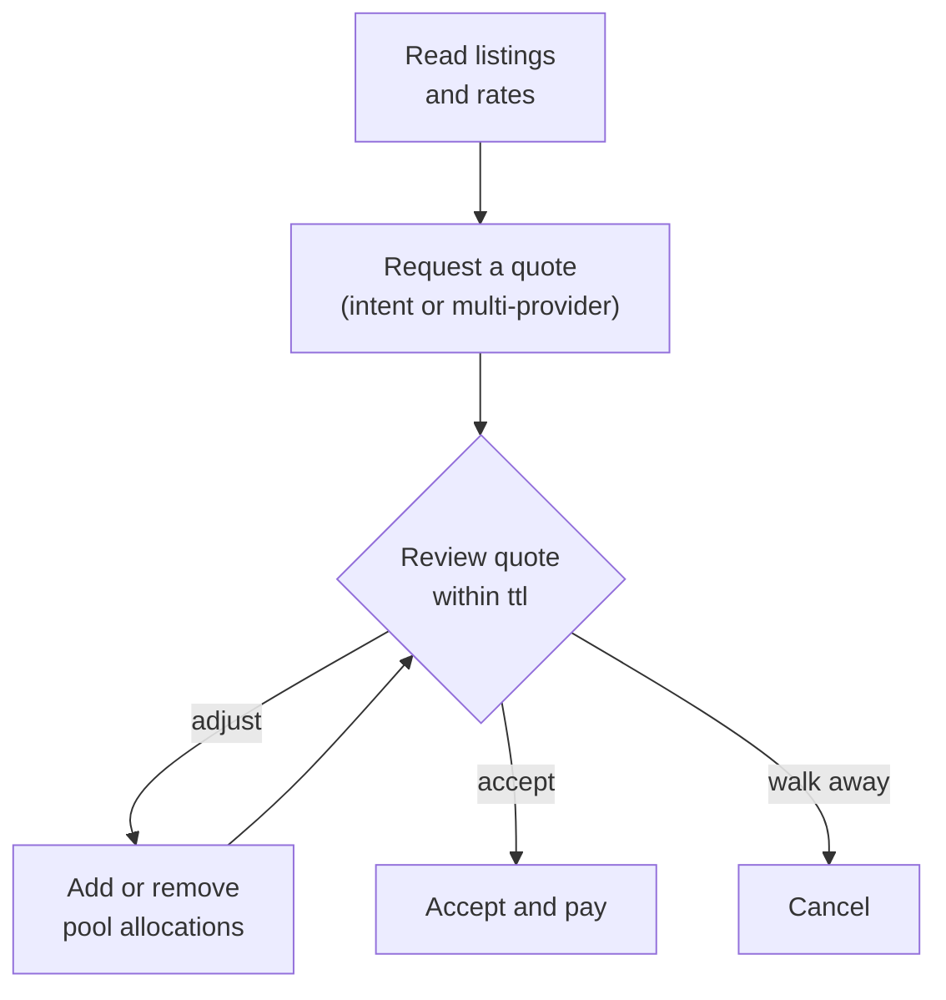

A request for quote (RFQ) is how you price a trade before you commit to it. You say what you want to trade, HyperRails returns a quote allocated across liquidity pools, and you decide whether to take it. Nothing moves until you accept.

## Choose how to request

| | Intent | Multi-provider quote |
|---|---|---|
| Endpoint | `POST /partners/marketplace/intent` | `POST /partners/marketplace/quote` |
| You send | The pair, the amount, its direction and **the rate you want** | The pair, the total amount and **the pools to use** |
| Who picks the pools | HyperRails | You |
| Use it when | You have a target rate | You've chosen specific providers from the marketplace |

Need to price and commit in one motion instead? Use an [express quote](/documentation/guides/take-a-quote-in-one-call).

## What you'll need

- Your **secret key**. See [Environments and credentials](/get-started/concepts/environments).
- The `accountId` you'll settle into, from [Read Your Balances](/documentation/guides/read-your-balances).
- A pair with liquidity behind it. See [Find a Liquidity Provider](/documentation/guides/find-a-liquidity-provider).

## The flow



<Steps>
  <Step title="Request the quote">
    **With an intent**, propose your rate:

    ```bash
    curl -X POST https://api.hyperrails.io/api/v1/partners/marketplace/intent \
      -H "Authorization: Bearer YOUR_SECRET_KEY" \
      -H "Content-Type: application/json" \
      -d '{
        "sourceCurrency": "GHS",
        "destinationCurrency": "NGN",
        "amount": 100,
        "amountDirection": "source",
        "rate": 128.77
      }'
    ```

    **With a multi-provider quote**, name the pools. Use the listing `id` as the `poolId`. See [Create Quote](/api-reference/hyperrail-quote/create-quote) for every field, including `fulfillmentType` and the chain fields required for on-ramps and off-ramps.

    Either way, you get back a quote in `PENDING` with a `quoteId`.
  </Step>

  <Step title="Review the quote">
    Quotes are valid for 30 minutes. Before the `ttl` runs out, check:

    - `allocationResult.fullAllocation`: whether the whole amount was matched
    - `allocationResult.weightedAverageRate`: the rate you'll actually get. It comes from the liquidity available and can differ from the rate you asked for
    - `totalSourceAmount` and `totalDestinationAmount`: what will be paid and what will be credited, including fees

    Read it again at any time with [Get Quote By ID](/api-reference/hyperrail-quote/get-quote-id).
  </Step>

  <Step title="Adjust the allocation, if needed">
    Change which pools fill the quote:

    - [Edit Quote](/api-reference/hyperrail-quote/edit-quote) (`PUT /partners/marketplace/quote/{id}/add`) adds a pool allocation, with a `poolId`, an `amount` and an `amountDirection`.
    - [Remove Quote Item](/api-reference/hyperrail-quote/delete-quote-item) (`PUT /partners/marketplace/quote/{id}/remove/{itemId}`) removes one.
  </Step>

  <Step title="Accept, or walk away">
    To take the quote, [accept it](/api-reference/hyperrail-quote/accept-quote) with the `accountId` and payment details. Then authorize, wait for the payment, and complete, exactly as in [Let a Buyer Pay for a Trade](/documentation/guides/buyer-pays-for-a-trade).

    To walk away, [cancel it](/api-reference/hyperrail-quote/cancel-quote). Cancelling abandoned quotes keeps your quote list clean.
  </Step>
</Steps>

## Negotiating on the dashboard

On the dashboard, buyers and sellers can chat inside the platform and send, accept and decline quotes, with a sound when a new message arrives. A listing's `negotiationLimit` shows whether the provider negotiates: `0` means the rate is take-it-or-leave-it.

## When things go wrong

| What you see | What it means | What to do |
|---|---|---|
| **400** `No providers available for the given intent configuration` | Nobody trades the pair | Pick a pair from the marketplace listings |
| **400** `Unable to fulfill requested volume at the moment.` | Bigger than the pools hold | Trade smaller, or add more pools |
| **400** on accept | The quote expired | Request a new quote |
