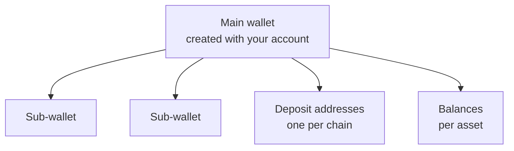

Every HyperRails account comes with a stablecoin wallet. It holds USDT and USDC, gives you deposit addresses on each supported chain, and sends stablecoins out without you managing gas.

<CardGroup cols={3}>
  <Card title="Multi-asset" icon="coins">
    Hold USDT and USDC in one wallet, with a separate balance for each.
  </Card>
  <Card title="Multi-chain" icon="link">
    One wallet, with a deposit address on each supported chain.
  </Card>
  <Card title="Gasless" icon="gas-pump">
    Send stablecoins without holding a native token to pay network fees.
  </Card>
</CardGroup>

## How wallets are organised



- Your **main wallet** is created automatically with your account. You have exactly one.
- **Sub-wallets** sit under the main wallet and keep their own balances. Money in the main wallet isn't spendable from a sub-wallet, which makes sub-wallets useful for separating funds.
- Each wallet has **deposit addresses**, one per supported chain, and **balances**, one per asset.

## Find your wallet

```bash
curl https://api.hyperrails.io/api/v1/wallets/main \
  -H "Authorization: Bearer YOUR_SECRET_KEY"
```

`main` works in place of a wallet ID. To list every wallet, including sub-wallets, call `GET /wallets` with `page` and `size`. The `walletId` in the response is what every other wallet call needs.

## Check the balance

```bash
curl https://api.hyperrails.io/api/v1/wallets/main/balances \
  -H "Authorization: Bearer YOUR_SECRET_KEY"
```

<Warning>
  Spend against `availableBalance`, never `balance`. The difference is held against pending activity.
</Warning>

## Gasless transactions

On most blockchains, sending a token also costs a fee paid in the chain's native token, such as ETH on Ethereum. HyperRails wallets support gasless transactions, so you can move USDT and USDC without topping up a separate native-token balance first.

## Next steps

<CardGroup cols={2}>
  <Card title="Receive stablecoins" icon="arrow-down" href="/documentation/guides/receive-stablecoins">
    Get a deposit address and know when funds arrive.
  </Card>
  <Card title="Send stablecoins" icon="paper-plane" href="/documentation/guides/send-stablecoins">
    Withdraw to an external wallet address.
  </Card>
</CardGroup>

For the full wallet walkthrough, including activity history, see [Check What a Wallet Holds](/documentation/guides/check-what-a-wallet-holds).
