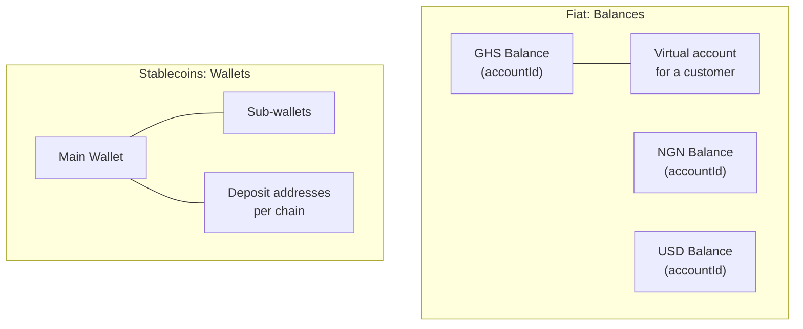

HyperRails keeps fiat money and stablecoins in two separate systems, each with its own endpoints.

## Fiat Balances

Each fiat currency you hold has its own **account**, identified by an `accountId`. That ID is what trades settle into and what payouts debit.

- `balance` is everything in the account. `availableBalance` is what you can spend right now.
- Not every supported currency is provisioned on every account. `GET /balances/currency-list?mode=live` lists what you could hold.

Guide: [Read Your Balances](/documentation/guides/read-your-balances)

## Virtual Accounts

A virtual account is a real, payable bank account number you give to a customer. They pay into it by normal bank transfer, and the money lands in the currency balance it sits under (its `parentAccountId`).

- Creating a virtual account isn't idempotent. Every call creates a new account number, so look up existing accounts before creating one.
- In test mode, virtual accounts are issued by a mock provider (Jollof Bank) and funded with the [Funding Simulator](/documentation/testing/funding-in-test-mode).

Guide: [Give a Customer an Account](/documentation/guides/give-a-customer-an-account)

## Stablecoin Wallets

Wallets hold stablecoins such as USDT and USDC, along with the on-chain addresses money arrives on.

- Your **main wallet** is created with your account. **Sub-wallets** sit under it and keep their own balances. Money in the main wallet isn't spendable from a sub-wallet.
- Spend against `availableBalance`, never `balance`. The difference is held against pending activity.

Guide: [Check What a Wallet Holds](/documentation/guides/check-what-a-wallet-holds)

<Warning>
  Stablecoins sent on an unsupported network, or to an incorrect address, may be lost permanently. Always confirm the chain before sending.
</Warning>

## Moving between them

| To… | Use |
|---|---|
| Convert one fiat balance to another | [Fiat exchange](/documentation/features/currency-exchange-fiat) or swap on the dashboard |
| Turn fiat into stablecoins | [On-ramp](/documentation/features/onramp-transaction) |
| Turn stablecoins into fiat | [Off-ramp](/documentation/features/offramp-transaction) |
| Send fiat to a bank account | [Fiat Payout](/documentation/features/fiat-payout-process) |
| Send stablecoins to an address | [Wallet Payout](/api-reference/payout/wallet-payout) |
