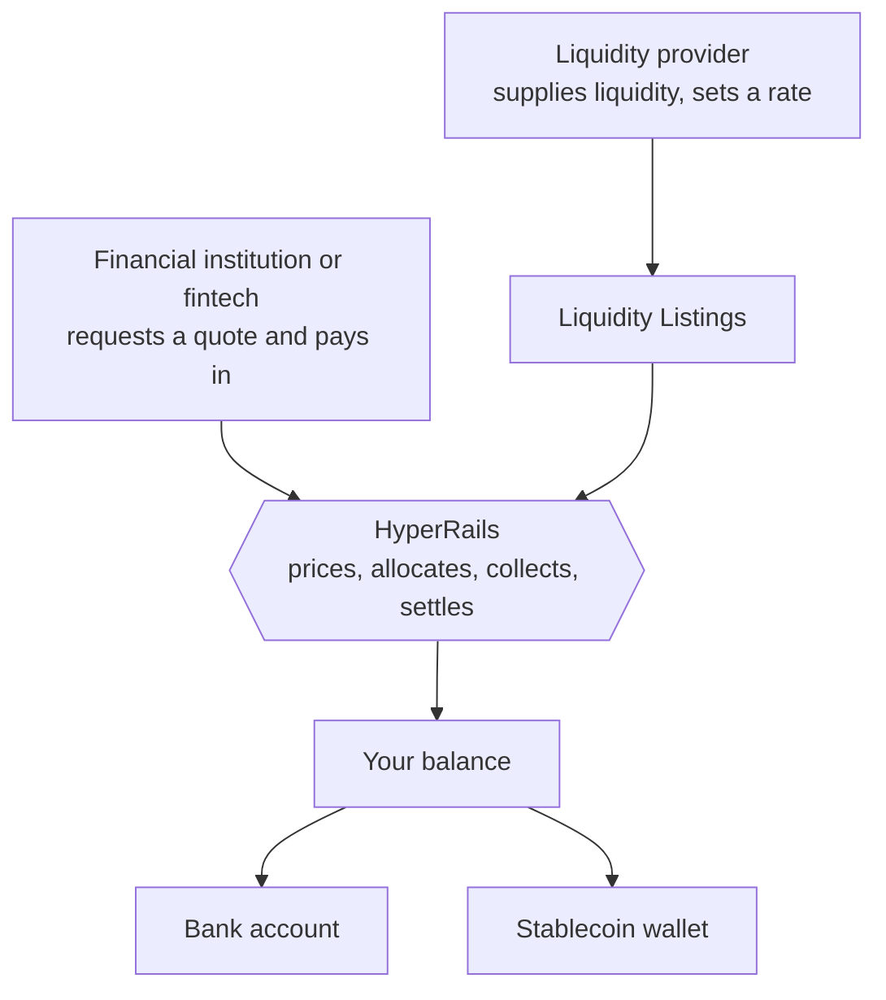

HyperRails is a marketplace for currency exchange built for **financial institutions and fintechs**. Liquidity providers put liquidity into the marketplace, financial institutions and fintechs trade against it, and HyperRails prices the trade, collects the payment, and settles the result into the right account. Stablecoins (USDT and USDC) act as the settlement layer, which is how a trade between two fiat currencies can settle without correspondent banking.

## The parties

<CardGroup cols={3}>
  <Card title="Financial institutions and fintechs" icon="building-columns">
    On-ramp, off-ramp, exchange currencies, pay in and pay out, using the liquidity on the marketplace.
  </Card>
  <Card title="Liquidity providers" icon="droplet">
    Financial institutions and fintechs that supply liquidity for currency pairs, set their own rates, and earn on executed trades.
  </Card>
  <Card title="HyperRails" icon="arrows-to-circle">
    Aggregates liquidity, prices quotes, collects pay-ins, settles trades, and sends payouts.
  </Card>
</CardGroup>

## The money flow

<Steps>
  <Step title="Liquidity is supplied">
    A liquidity provider creates a trade request for a currency pair, either **funded** (money added right away) or **unfunded** (approved by an admin first), and sets the rate they will trade at. Each one appears on liquidity listings under a trading alias, so business names stay hidden.
  </Step>
  <Step title="A quote is priced">
    You ask to trade a pair. HyperRails allocates the trade across one or more liquidity providers and returns a quote showing who is filling it and at what `weightedAverageRate`. See [Quotes](/get-started/concepts/quotes).
  </Step>
  <Step title="The quote is accepted and paid">
    Accepting the quote locks the trade and starts the countdown. You pay from your HyperRails balance, by bank transfer, by mobile money, or by stablecoin deposit.
  </Step>
  <Step title="The trade settles">
    Once the payment is confirmed and the trade is completed, the destination amount lands in your balance, and the provider's available liquidity drops by what was taken.
  </Step>
  <Step title="Funds move on">
    You can hold the funds, swap them into another balance, or pay them out to a bank account or a stablecoin wallet.
  </Step>
</Steps>

## Two ways to work

| | Dashboard | Partner API |
|---|---|---|
| Who it's for | Teams operating day to day | Platforms integrating HyperRails into their product |
| Where | [app.hyperrails.io](https://app.hyperrails.io) | `https://api.hyperrails.io` |
| Get access | Sign up and complete onboarding | Granted per partner during onboarding. Contact [support@hyperrails.io](mailto:support@hyperrails.io) |
| Start here | [Onboard with us](/documentation/onboarding) | [API introduction](/api-reference/introduction) |

Most businesses start on the dashboard and move to the API as their volume grows.

## Core concepts

<CardGroup cols={2}>
  <Card title="Accounts and balances" icon="scale-balanced" href="/get-started/concepts/accounts-and-balances">
    Currency balances, virtual accounts and stablecoin wallets.
  </Card>
  <Card title="Liquidity" icon="droplet" href="/get-started/concepts/liquidity">
    Pools, the marketplace, and why available balance matters.
  </Card>
  <Card title="Quotes" icon="file-invoice-dollar" href="/get-started/concepts/quotes">
    Intents, express quotes, allocations and time to live.
  </Card>
  <Card title="Environments and credentials" icon="key" href="/get-started/concepts/environments">
    Test and live mode, and your API keys.
  </Card>
  <Card title="Transaction lifecycle" icon="arrows-spin" href="/get-started/transaction-lifecycle">
    Every status a trade passes through, and the webhook for each.
  </Card>
</CardGroup>
