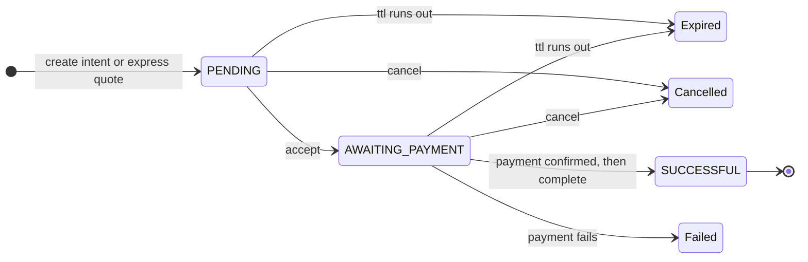
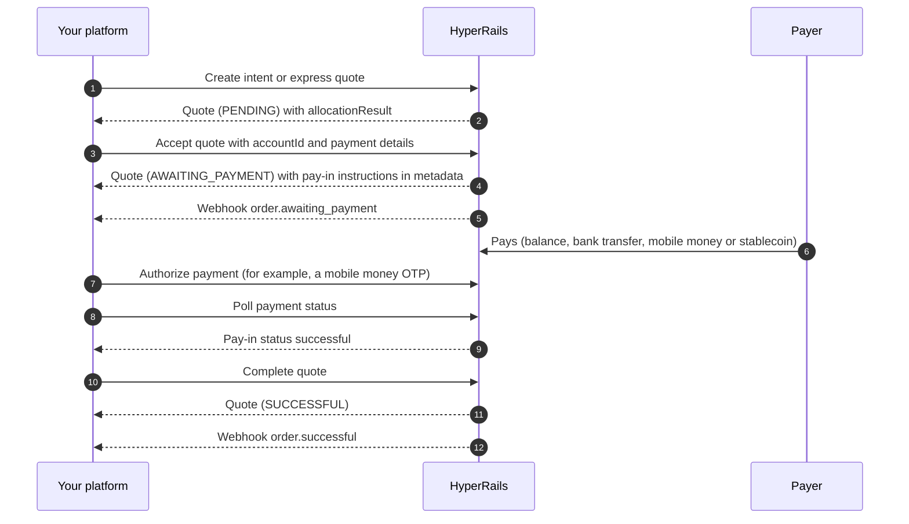

Every trade on HyperRails is a **quote** that moves through a fixed set of stages. Knowing those stages tells you which call to make next, what to show your customer, and which webhook to wait for.

## The stages at a glance

| Stage | What it means | How you get here | Webhook event |
|---|---|---|---|
| `PENDING` | The trade is priced and allocated to liquidity pools, but not committed. | [Create an intent](/api-reference/hyperrail-quote/create-payment-intent) or an [express quote](/api-reference/hyperrail-quote/create-express-quote) | — |
| `AWAITING_PAYMENT` | The trade is locked and waiting for the pay-in. | [Accept the quote](/api-reference/hyperrail-quote/accept-quote) | `order.awaiting_payment` |
| `SUCCESSFUL` | The pay-in is confirmed and the destination amount has been credited. | [Complete the quote](/api-reference/hyperrail-quote/get-complete-quote-id) | `order.successful` |
| Failed | The payment didn't go through. | — | `order.failed` |
| Cancelled | The quote was cancelled before it settled. | [Cancel the quote](/api-reference/hyperrail-quote/cancel-quote) | `order.cancelled` |
| Expired | The quote's time to live ran out before it was paid. | — | `quote.expired` |

See [Webhook payloads](/documentation/webhooks/payloads) for the body of each event.

## The calls in order

## Quote validity (time to live)

Every quote is valid for **30 minutes**. Its `ttl` field shows the seconds it has left, starting at `1800`, and a completed quote reports a `ttl` of `0`.

On the dashboard, the same countdown appears as the timer on the payment page of every order, with a pop-up when the time is extended.

<Warning>
  Give up against `ttl`, not against a fixed number of retries. When it reaches zero, the quote expires and you'll receive `quote.expired`.
</Warning>

## Watching the payment

While a quote is `AWAITING_PAYMENT`, the pay-in has its own status inside `metadata`. For mobile money, that's `metadata.mobileMoneyPayIn.status`, which moves from `inProgress` to `successful`.

The top-level quote status stays `AWAITING_PAYMENT` until you call complete. A successful pay-in on a quote that still reads `AWAITING_PAYMENT` is expected, not a stuck trade. See [Let a Buyer Pay for a Trade](/documentation/guides/buyer-pays-for-a-trade) for the full walkthrough.

## Payouts

Payouts have their own lifecycle. A [fiat payout](/api-reference/payout/withdrawal) starts as `PROCESSING` and reports the upstream provider's view in `providerStatus`. Check it with [Get Payout Status](/api-reference/payout/payout-status) using your `reference`.

## Deposits

Money arriving outside a trade triggers its own events:

| Event | When |
|---|---|
| `account.credit_successful` | A fiat account is credited, for example a payment into a [virtual account](/documentation/guides/give-a-customer-an-account). |
| `wallet.credit_successful` | A stablecoin wallet receives an on-chain deposit. |
| `wallet.debit_successful` | A stablecoin wallet is debited. |
