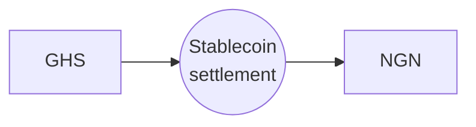

HyperRails exchanges fiat currencies through stablecoins: **Fiat A → stablecoin → Fiat B**. You see one quote and one rate. HyperRails handles the legs, the pricing and the liquidity.

## When to use it

- Paying suppliers or partners in another African currency
- Rebalancing a multi-currency treasury
- Preparing funds for local payouts in another market
- Reducing exposure to a single currency

## How it works

<Steps>
  <Step title="Check there's a provider">
    Read the [marketplace listings](/documentation/guides/find-a-liquidity-provider) for your pair. A published rate doesn't mean anyone is offering to trade.
  </Step>
  <Step title="Get a quote">
    Use an [intent](/documentation/guides/buyer-pays-for-a-trade) if a person needs to review the rate, or an [express quote](/documentation/guides/take-a-quote-in-one-call) to price and commit in one motion.
  </Step>
  <Step title="Pay and complete">
    Accept the quote, pay in, then complete it. The destination amount is credited to your balance in the target currency.
  </Step>
  <Step title="Pay out">
    Send the proceeds to a bank account with a [fiat payout](/documentation/features/fiat-payout-process).
  </Step>
</Steps>

## Supported currencies

See [Coverage](/documentation/coverage) and [Supported currencies and networks](/documentation/supported-currencies). Live mode supports fewer currencies than test mode. Check `GET /balances/currency-list?mode=live` for what your account can hold.

## On the dashboard

The same flow is available without code. See [Currency exchange (fiat)](/documentation/features/currency-exchange-fiat).
