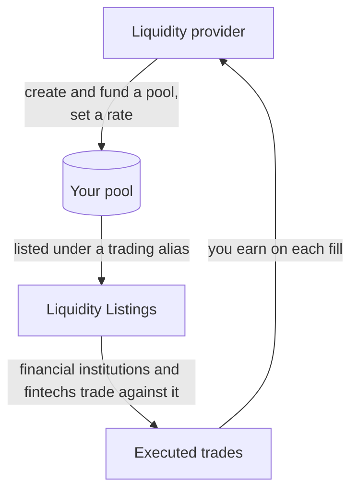

Liquidity providers are the liquidity behind every HyperRails trade. You fund pools for the currency pairs you want to trade, set your rate, and earn on every trade that's filled from your pool.

## How it Works

<Steps>
  <Step title="Onboard to supply liquidity">
    Choose the liquidity service type at sign-up, then complete verification. See [Onboard with us](/documentation/onboarding).
  </Step>
  <Step title="Fund your Balances">
    Add funds to the currencies you want to trade.
  </Step>
  <Step title="Create a Pool">
    Pick the source and destination currency, then choose a markup (manual, percentage or plus). Make the pool **funded** (money added now) or **unfunded** (approved by an admin first). For stablecoin pairs, pick the chain.
  </Step>
  <Step title="Set Alerts">
    Set rate and liquidity thresholds so you know when to refresh your rate or top up.
  </Step>
  <Step title="Go Live">
    Your pool is listed on the marketplace under a trading alias. Your business name stays hidden.
  </Step>
</Steps>

## Managing your Pools

- Edit, pause, resume, top up and delete pools at any time. A pool can't be deleted while a trade is in progress.
- Set an expiry date on a pool. Expired pools are archived automatically and stay viewable.
- Chat with buyers and send, accept or decline quotes inside the platform.
- Invite sub-merchants, view your trade history with each one, and suspend them if needed.

## Learn more

- [Liquidity](/get-started/concepts/liquidity): how trades are allocated across pools
- [Find a Liquidity Provider](/documentation/guides/find-a-liquidity-provider): what financial institutions and fintechs see when they look at your listing
