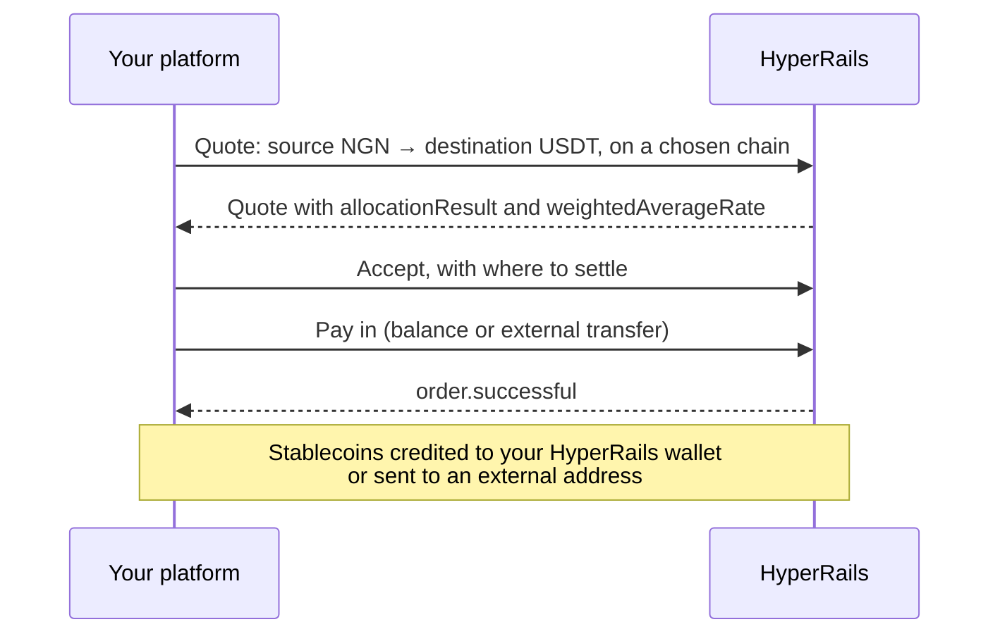

**On-ramp** converts local currency into stablecoins. **Off-ramp** converts stablecoins back into local currency. Both are trades against the Liquidity Marketplace, so they follow the same [quote lifecycle](/get-started/transaction-lifecycle).

<Columns cols={2}>
  <Card title="On-ramp" icon="arrow-up">
    Fiat → USDT or USDC. Fund stablecoin balances, convert local collections, or prepare funds for cross-border payouts.
  </Card>
  <Card title="Off-ramp" icon="arrow-down">
    USDT or USDC → fiat. Settle stablecoin balances into local currency and pay out to a bank account.
  </Card>
</Columns>

## How an on-ramp works

For on-ramps, the quote needs the chain the stablecoins settle on. For off-ramps, it needs the chain the stablecoins come from.

## How an off-ramp works

1. Request a quote from a stablecoin to a fiat currency.
2. Accept it, with the account to settle into.
3. Send the stablecoins to the deposit instructions in the quote's `metadata`, or pay from your wallet balance.
4. Complete the trade, then [pay out to a bank account](/documentation/features/fiat-payout-process) if needed.

## Choose your path

| | Dashboard | API |
|---|---|---|
| On-ramp | [On-ramp transactions](/documentation/features/onramp-transaction) | [Take a Quote in One Call](/documentation/guides/take-a-quote-in-one-call) |
| Off-ramp | [Off-ramp transactions](/documentation/features/offramp-transaction) | [Request for quote](/documentation/guides/request-for-quote) |

## Before you go live

- Check there's liquidity for your pair and size. See [Find a Liquidity Provider](/documentation/guides/find-a-liquidity-provider).
- Confirm the chain for every stablecoin leg. See [Supported currencies and networks](/documentation/supported-currencies).
- Rely on [webhooks](/documentation/webhooks/overview) for the final outcome, not on the response to your last call.
