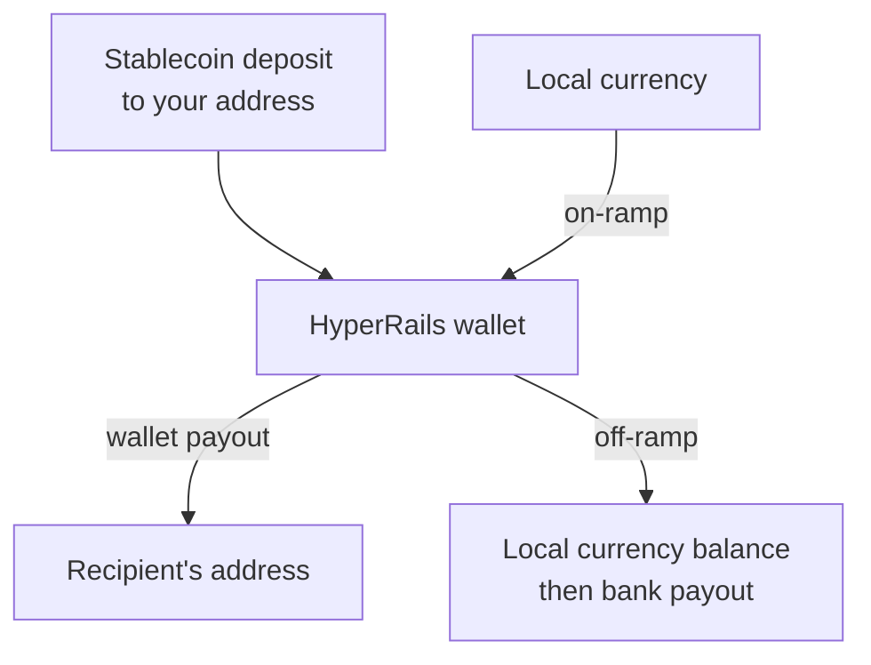

Stablecoins move value across borders in minutes and aren't exposed to local currency volatility. HyperRails gives you wallets to hold them, deposit addresses to receive them, payouts to send them, and liquidity to convert them to and from local currency.

<Check>
  Every HyperRails account comes with a **multi-chain wallet that supports gasless transactions**. Hold, receive and send USDT and USDC across supported networks without keeping a separate native token to pay network fees. See [Stablecoin wallets](/documentation/guides/stablecoin-wallets).
</Check>

## What you can build

<CardGroup cols={2}>
  <Card title="Hold Dollars" icon="vault">
    Keep treasury in USDT or USDC in a HyperRails wallet, with sub-wallets to separate funds.
  </Card>
  <Card title="Receive Stablecoins" icon="arrow-down">
    Share a deposit address on a supported chain and get a `wallet.credit_successful` webhook when funds arrive.
  </Card>
  <Card title="Send Stablecoins" icon="paper-plane">
    Pay suppliers or partners straight to their wallet address, gasless, so there's no native token to top up first.
  </Card>
  <Card title="Convert at market liquidity" icon="arrow-right-arrow-left">
    Move between stablecoins and local currency through Liquidity Listings.
  </Card>
</CardGroup>

## How it works

<Steps>
  <Step title="Find your Wallet">
    Your main wallet is created with your account. Read its balances and deposit addresses. See [Check What a Wallet Holds](/documentation/guides/check-what-a-wallet-holds).
  </Step>
  <Step title="Fund it">
    Receive a deposit on a supported chain, or on-ramp from a local currency balance. See [On-ramp and off-ramp](/use-cases/on-off-ramp).
  </Step>
  <Step title="Send it">
    Create a [wallet payout](/api-reference/payout/wallet-payout) with a unique `reference`, the `chain`, the `asset`, the `amount` and the `toAddress`.
  </Step>
  <Step title="Track it">
    Listen for `wallet.debit_successful`, and reconcile on your `reference`.
  </Step>
</Steps>

## What's supported

- **Stablecoins:** USDT and USDC
- **Networks:** see [Supported currencies and networks](/documentation/supported-currencies). The [Wallet Payout](/api-reference/payout/wallet-payout) reference lists the chains each endpoint accepts.

<Warning>
  Stablecoins sent on an unsupported network, or to an incorrect address, may be lost permanently. Validate the address and confirm the chain before every payout.
</Warning>

## Related

- [Bridge](/get-started/platform-overview): convert between a currency and its matching stablecoin, for example USD to USDT
- [Integration Security](/documentation/guides/integration-security)
